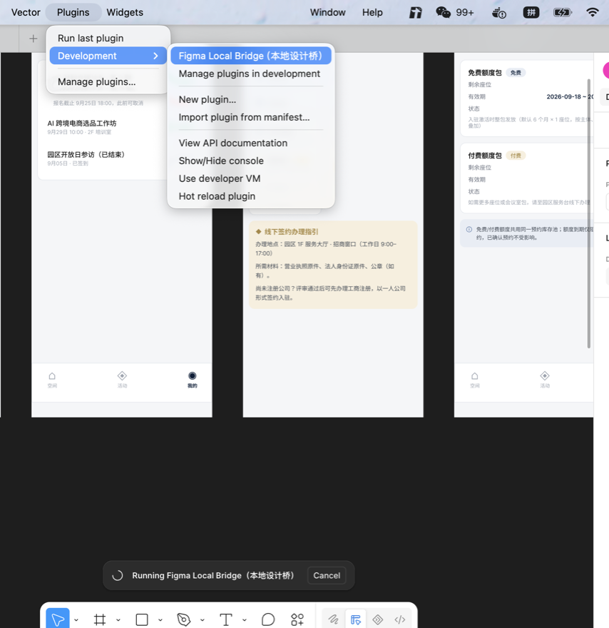

# 插件安装与配置指南

figma-local-bridge 由两部分组成：**Figma 桌面端插件**（在画布沙箱内执行命令）和**本地中继**（在你的机器上监听 9741 端口）。本指南带你完成插件侧的一次性配置。

## 前提

- **Figma 桌面客户端**（macOS / Windows）。网页版不能加载开发插件，这是 Figma 的硬性限制。
- Node.js ≥ 18。

## 第一步：安装插件文件

```bash
npx figma-bridge install-plugin
```

插件文件会被安装到 `~/figma-local-bridge-plugin`（故意用非隐藏目录——macOS 的打开对话框默认不显示以点开头的目录，曾经有人把插件装进隐藏目录后怎么也选不到 manifest 文件）。

## 第二步：在 Figma 桌面端导入插件

1. 打开 Figma 桌面客户端
2. 菜单栏 **Plugins → Development → Import plugin from manifest…**
3. 选择 `~/figma-local-bridge-plugin/manifest.json`

导入成功后，插件会出现在 **Plugins → Development** 菜单的最上方：



图中底部的 "Running Figma Local Bridge（本地设计桥）" 状态条表示插件正在后台运行——插件没有界面，保持这个状态即可。

## 第三步：每次使用的三件事

1. 终端运行 `npx figma-bridge server`（保持运行）
2. 打开目标 Figma 文件，运行一次 **Plugins → Development → Figma Local Bridge**（只在文件关闭重开或 Figma 重启后需要）
3. `npx figma-bridge doctor` 自检，全绿即连通

## 常见问题

**doctor 报「插件离线」**——在 Figma 里重新运行一次插件即可，插件会自动重连中继。

**doctor 报「版本不一致」**——包升级后插件文件没更新，重跑 `npx figma-bridge install-plugin`，然后在 Figma 里重启插件（Plugins → Development 里再点一次）。

**改了端口**——中继侧用环境变量 `FLB_PORT=新端口`；插件侧改 `plugin/code.js` 顶部的 `SERVER` 常量，然后重新 install-plugin + 重启插件。

**Import plugin from manifest 是灰的**——你用的是网页版 Figma，请换桌面客户端。
